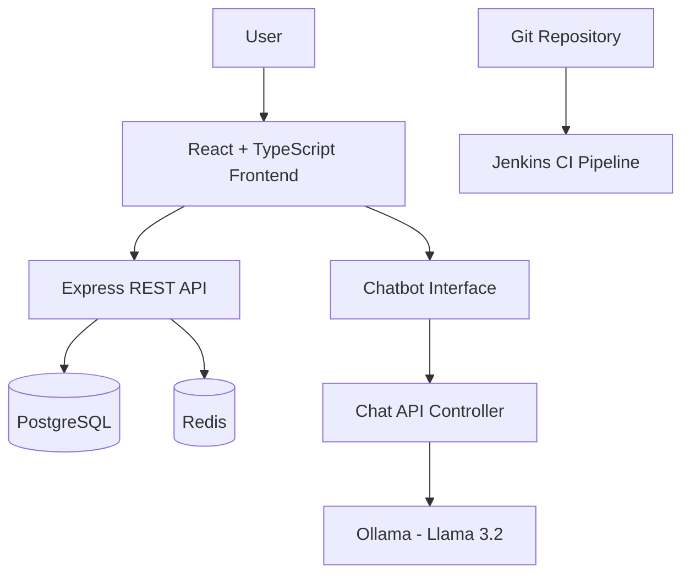

# 🎟️ EventBooking — Full-Stack Event Management Platform

A full-stack event booking and management platform built with React, TypeScript, Node.js, and Express. The project combines event management workflows with an AI-powered chatbot and DevOps automation to demonstrate modern full-stack development practices.

**Core focus:** Full-stack engineering • REST API development • AI integration • Database management • CI/CD automation

## 🚀 Key Features

### 🎫 Event Management
- Browse events and view detailed event information.
- Support event creation and management workflows.
- Provide dedicated interfaces for users, organizers, and administrators.
- Manage bookings and related user workflows.

### 🤖 AI-Powered Chatbot
- Integrated chatbot interface within the React frontend.
- Backend API integration for handling chat requests.
- Local LLM inference using Ollama and Llama 3.2.
- Designed to provide conversational assistance for event-related questions.

### 🔐 Authentication and Access Control
- Authentication and protected-route components.
- Role-oriented interfaces for different types of users.
- Centralized frontend services and state management.

### ⚙️ Backend Engineering
- REST API architecture using Node.js and Express.
- Separated route and controller responsibilities.
- PostgreSQL database integration using Prisma.
- Redis integration for supporting backend services.
- WebSocket configuration for real-time communication.

### 🛠️ DevOps and Automation
- Jenkins pipeline for continuous integration.
- Git-based source control and version management.
- Docker-based Redis setup for local development.
- Environment-based application configuration.

## 🧰 Technology Stack

| Layer | Technologies |
|---|---|
| Frontend | React, TypeScript, Vite |
| Backend | Node.js, Express.js |
| Database | PostgreSQL, Prisma |
| Caching / Messaging | Redis |
| AI Integration | Ollama, Llama 3.2 |
| Real-time Communication | WebSockets |
| DevOps | Jenkins, Git, Docker |

## 🏗️ Architecture Overview



The frontend communicates with the Express backend through HTTP APIs. The backend handles application requests and database interactions, while the chatbot controller connects chat requests to a locally running Ollama model. Jenkins provides a CI pipeline for the development workflow.

## 📂 Project Structure

```text
EventBooking-DevOps/
├── frontend/
│   ├── components/
│   │   ├── auth/
│   │   ├── features/
│   │   │   ├── Chatbot.tsx
│   │   │   └── Chatbot.css
│   │   ├── layout/
│   │   └── ui/
│   ├── pages/
│   ├── services/
│   ├── store/
│   ├── App.tsx
│   └── main.tsx
├── backend/
│   ├── src/
│   │   ├── controllers/
│   │   ├── routes/
│   │   └── app.js
│   └── prisma/
├── Jenkinsfile
├── index.html
├── package.json
└── README.md
```

## ⚡ Getting Started

### Prerequisites

- Node.js and npm
- PostgreSQL
- Docker
- Ollama with the required language model
- Git

### 1. Clone the repository

```bash
git clone https://github.com/anmolbeast1/EventBooking-DevOps.git
cd EventBooking-DevOps
```

### 2. Configure the backend

```bash
cd backend
npm install
```

Create a local `backend/.env` file using the environment variables required by the backend configuration. Configure your PostgreSQL connection and other required settings. Never commit credentials or secret keys.

Run any required Prisma setup commands according to the project's schema and migration configuration.

### 3. Start Redis

If using the local Docker setup:

```bash
docker run -d --name redis -p 6379:6379 redis
```

If a container named `redis` already exists, start that container instead of creating another one.

### 4. Start Ollama

Install Ollama and download the model used by the application:

```bash
ollama pull llama3.2
```

Ensure Ollama is running and the backend can access its local API.

### 5. Start the backend

From the `backend` directory, use the development script defined in `backend/package.json`, for example:

```bash
npm run dev
```

### 6. Start the frontend

Open a second terminal in the project root:

```bash
npm install
npm run dev
```

Configure `.env.development` with the appropriate local API and WebSocket URLs.

The frontend, backend, database, Redis, and Ollama services must be running and correctly configured for all features to work.

## 🔄 CI/CD Workflow

The repository includes a Jenkins pipeline defined in `Jenkinsfile`.

The CI workflow is intended to support repeatable development checks and automated build steps. Refer to the pipeline configuration for the exact stages and commands currently implemented.

## 🔒 Security Notes

- Keep `.env` files and credentials out of version control.
- Use environment variables for sensitive configuration.
- Never expose database passwords, authentication secrets, or private API keys.
- Use appropriate authentication, authorization, and input validation in production.

## 🗺️ Future Improvements

- Deploy the frontend and backend with production-ready configuration.
- Add automated unit and integration tests.
- Introduce GitHub Actions or expand the existing CI pipeline.
- Add API documentation and architecture diagrams.
- Add monitoring, structured logging, and health checks.
- Improve chatbot knowledge retrieval and error handling.

## 👨‍💻 Author

**Anmol Sharma**

Computer Science Engineering | Full-Stack Development | DevOps | AI Integration

- GitHub: [@anmolbeast1](https://github.com/anmolbeast1)

---

If you find this project useful, consider starring the repository and sharing feedback or suggestions for improvement.

*Built as a hands-on project to explore full-stack application development, AI integration, and DevOps practices.*
